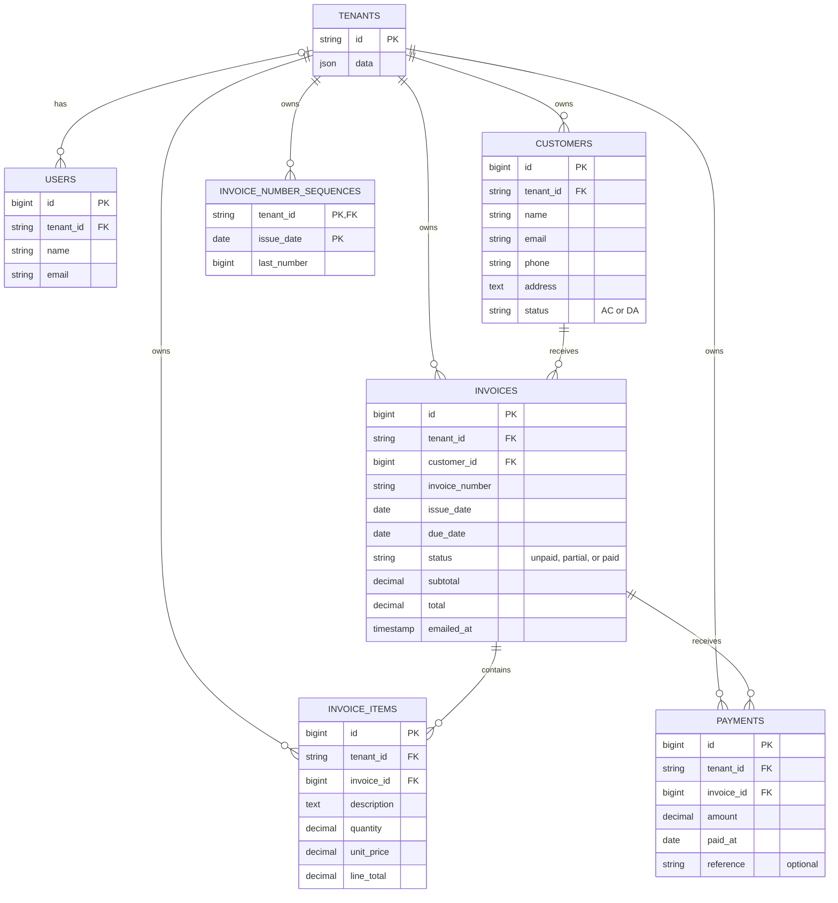

# Accounting database ERD

The application uses one PostgreSQL database. Each business record carries a tenant ID. Framework infrastructure tables are omitted from the diagram.

An invoice references a customer through `(tenant_id, customer_id)`. An item or payment references its invoice through `(tenant_id, invoice_id)`. These composite foreign keys reject references across companies, even if an application query omits its tenant filter.

Invoice numbers are unique within a company through `(tenant_id, invoice_number)`. The sequence table uses `(tenant_id, issue_date)` as its primary key so each company has a separate counter per issue date. Invoice edits preserve the number, and deletion leaves the counter intact.

The authenticated user's company initializes tenant context before route binding. Eloquent scopes restrict business queries to that company. The overdue command iterates companies, and the mail job initializes the company identified in its payload before loading the invoice.
