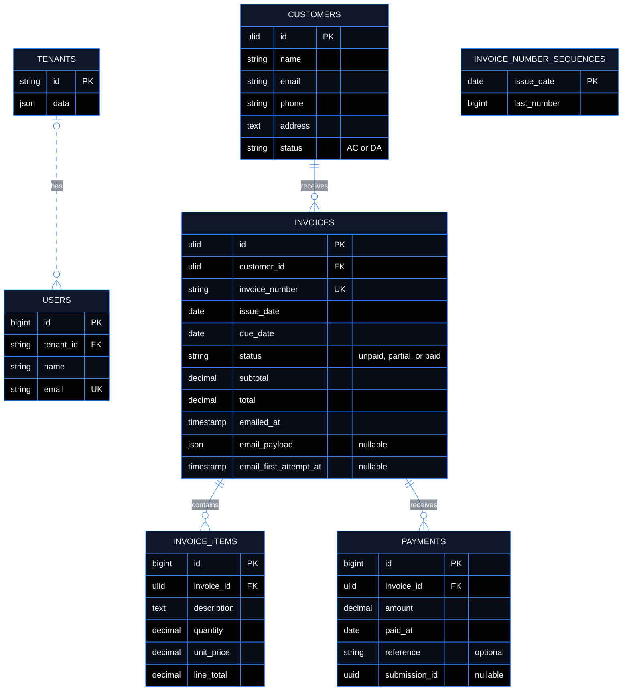

# Accounting database ERD

The central PostgreSQL database holds the `tenants` and `users` tables. Each company has its own PostgreSQL database containing the business tables. The diagram omits framework infrastructure tables.

Each invoice references a customer in its company's database. Items and payments reference invoices in the same database. Invoice and customer IDs are ULIDs, so links from another company do not resolve even when two companies have the same invoice number.

The tenant database enforces invoice-number uniqueness and keeps one sequence per issue date. Invoice edits preserve the number, and deletion leaves the counter intact.

The authenticated user's company selects the tenant connection before Laravel binds route models. The overdue command iterates companies, and the mail job selects its tenant database using the company ID in the job payload.
